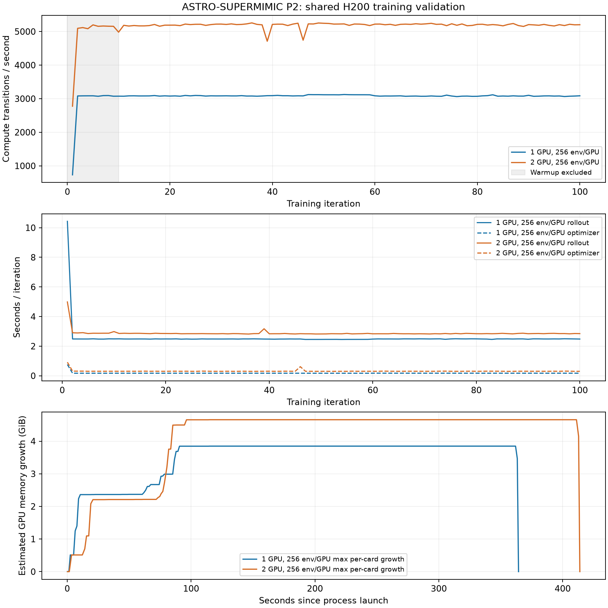

# ASTRO-SUPERMIMIC P2：H200 单卡 / 双卡真实训练验证

2026-10-29 完成。单卡和双卡各完成 100 次真实 PPO/FSQ 训练迭代，模型、优化器和推理 checkpoint 验证通过。测试结束后进程已退出，所用 GPU 的显存回到各自测试前基线，没有停止其他任务。

本轮采用 **ASTRO-SUPERMIMIC 的 512 条完整 motion 验证子集**，并非完整 88,883 条数据集。结果是共享 H200 上的短程稳定性与吞吐验证，不是长期收敛、策略质量或独占 GPU 极限性能验收。

## 核心结果

| 指标 | 单卡：GPU 2 | 双卡：GPU 2、3 |
|---|---:|---:|
| 每卡环境数 | 256 | 256 |
| 全局环境数 | 256 | 512 |
| 每卡 minibatch | 1,024 | 1,024 |
| 每次 rollout 控制步 | 32 | 32 |
| 完成迭代 | 100 | 100 |
| 全局环境步 | 819,200 | 1,638,400 |
| 稳态吞吐，含日志/保存 | **2,956 步/秒** | **4,997 步/秒** |
| 稳态吞吐，只计 rollout + 优化 | 3,087 步/秒 | 5,194 步/秒 |
| 稳态 rollout 吞吐 | 3,303 步/秒 | 5,753 步/秒 |
| rollout 平均耗时/迭代 | 2.480 秒 | 2.848 秒 |
| 优化平均耗时/迭代 | 0.173 秒 | 0.307 秒 |
| Torch allocated 峰值，每进程最大值 | 2.13 GiB | 2.12 GiB |
| Torch reserved 峰值，每进程最大值 | 2.44 GiB | 2.43 GiB |
| GPU 新增显存采样峰值 | **3.85 GiB** | **4.66 / 4.14 GiB** |
| 所用卡最低实际空闲显存 | 9.26 GiB | 4.47 / 4.98 GiB |
| 包括启动的整次运行耗时 | 364.4 秒 | 413.9 秒 |

双卡稳态吞吐为单卡的 **1.69 倍**，相当于理想两倍吞吐的约 84.5%。每卡环境数不变，所以双卡每轮样本数翻倍；这个比较衡量扩展吞吐，不是相同总样本预算下的策略质量对照。

统计剔除前 10 次预热，使用第 11–100 次迭代。双卡按较慢 rank 的耗时计算全局吞吐。环境步指 50 Hz 控制步，每步包含 4 个 200 Hz 物理子步。`含日志/保存`口径包含相邻迭代间日志和 checkpoint 开销；启动、首次编译及前 10 次迭代单独排除。



## 稳定性证据

- 两次正式运行均正常退出，返回码 0，没有 OOM 或 NaN/Inf 失败。
- 启用了 `agent.fail_on_bad_grads=True`；actor、critic 坏梯度计数全程为 0，actor update-skipped 指标为 0。
- 所有记录的训练 loss、KL 和梯度统计均为有限值；每轮末检查物理 qpos/qvel，每 10 轮检查模型参数，均通过。
- 两个训练 checkpoint 的 epoch 均为 100；critic optimizer 中的 step 均为 800，确认实际进行了优化器更新。
- 两个训练 checkpoint 及两个推理 checkpoint 的浮点张量均通过有限性检查。
- 原生 TensorBoard 中，平均 episode 长度由约 15.6 步提高到单卡 40.7 步、双卡 51.9 步。这说明训练确实在推进，但 episode 仍很短，不能据此宣称已经获得稳定运动策略。
- 原有 PyTorch AccumulateGrad stream 警告仍会出现，本次未阻止更新或 DDP；没有进行专项性能调优。

## 数据来源与复制

源机：`atom5@172.16.9.22`（5090 1号）。

原始版本：

```text
/data/atom5/code/datasets/ASTRO-SUPERMIMIC/astro_supermimic_88883_20261022/p2_motionlib
```

原始 8 个分片合计 88,883 条 motion、60,678,065 帧，约 114.3 GB，每片约 14.3 GB。整片加载再加接触平滑和训练状态不适合当时的剩余显存，因此从全部 8 个分片确定性抽取了 512 条完整 motion。

| 来源 | 条数 |
|---|---:|
| AMASS | 44 |
| BVH | 324 |
| fzmotion_50hz | 7 |
| hiphi_51_all | 18 |
| hiphi_all | 56 |
| running | 59 |
| LAFAN1 | 4 |

子集共 **483,995 帧**，保留原有 50 FPS、完整时长、轨迹、关节状态、接触标签和 motion 权重，不裁帧、不重采样。抽样包含各来源的长度极值和固定种子的样本；只重建拼接后的帧偏移。单卡和双卡使用同一份子集，双卡每个 rank 都加载这份 MotionLib。

H200 数据路径：

```text
/data/workspace/datasets/ASTRO-SUPERMIMIC/astro_supermimic_88883_20261022/validation_512/astro_supermimic_p2_validation_512.pt
```

文件大小：911,417,317 字节。源端生成和 H200 接收后的 SHA256 一致：

```text
e79bd8df79f4845b9ec05de002b20c5f7545a58c368c6d484dd0b157e7a9e56e
```

左右脚接触标签占比分别约 59.8% 和 57.3%，不是之前的合成站立测试标签。H200 端安全读取检查通过：索引、有限值、接触标签，以及 P2 模型 SHA256 一致。完整抽样清单在数据目录的 `manifest.json`，目标检查在 `target_validation.json`。复制限速 16 MiB/s，源端抽取只使用 CPU、2 个线程及低 I/O 优先级。

## 对其他任务的保护与测量限制

- 不修改其他进程，不抢占已分配显存，不改驱动或 GPU 全局设置；训练使用低 CPU 调度优先级和单线程数值库。
- 每个训练进程的 PyTorch CUDA allocator 硬预算为 **3 GiB**。MuJoCo/Warp、CUDA context、NCCL 等分配不计入该 allocator，因此另用 GPU 实际空闲显存监控保护。
- 单卡正式运行预留至少 8 GiB；经用户允许共享剩余显存后，最终双卡正式运行预留至少 **4 GiB**，实测最低 4.47 GiB。监控每秒采样，只能停止自己创建的进程组。
- 早期双卡尝试曾被保守的增量门槛主动停止：一次触及设定阈值，随后两次受到其他任务重载及各卡不同步分配的影响。这些是资源保护退出，不计作已完成训练或吞吐结果，记录全部保留。
- 最终双卡以实际空闲显存判定停止，不再把不可靠的占用归因用作停止依据；增量仍保留估算和参考卡校正字段。最终正式运行期间背景显存稳定，结束后两卡均回到 133,811 MiB 的原有占用。
- NVML 在当前容器内未暴露可用的进程级显存清单，因此“GPU 新增显存”是总卡占用相对背景的采样增量，不是进程级精确核算。Torch allocated/reserved 是进程内直接测量。
- 测试在共享 GPU 上运行，不能证明对其他任务的计算调度完全无影响，也不能将本次吞吐视为独占性能。可以确认没有停止其他任务、没有出现内存不足，并已释放本次新增占用。

## 产物与复现

仓库：`/data/workspace/ProtoMotions`

分支 / 提交：`codex/mjlab-h200` / `21be04e3c4d6a256f0c4f32ed016e711c6822377`。本轮未修改后端或学习算法代码。

环境：`/opt/venvs/protomotions-mjlab`。Python 3.12.3、Torch 2.11.0+cu128、mjlab 1.6.0、MuJoCo / MuJoCo Warp 3.11.0、Warp 1.18.0。

结果目录：

```text
/data/workspace/ProtoMotions/results/mjlab_astro512_single256_20261029/
/data/workspace/ProtoMotions/results/mjlab_astro512_dual256_budget4_20261029/
```

每个目录包含 `last.ckpt`、`inference_last.ckpt`、冻结配置与 TensorBoard 日志。

测量脚本、逐 rank 指标、GPU 采样、启动参数和检查结果：

```text
/data/workspace/mjlab-build/realbench_20261029/
```

使用新 label 复现，以免覆盖结果；启动检查会在余量不足时拒绝运行：

```bash
/opt/venvs/protomotions-mjlab/bin/python \
 /data/workspace/mjlab-build/realbench_20261029/run_guarded.py \
 --gpus 2,3 --label mjlab_astro512_dual256_repeat \
 --num-envs 256 --batch-size 1024 --iterations 100 \
 --max-growth-mib 5120 --min-free-mib 4096 --headroom-only
```

最终已没有本次训练或监控进程留在后台，也没有启动正式长期训练。完整原始分片尚未复制到 H200，本轮复制并使用的是上述真实数据验证子集。
